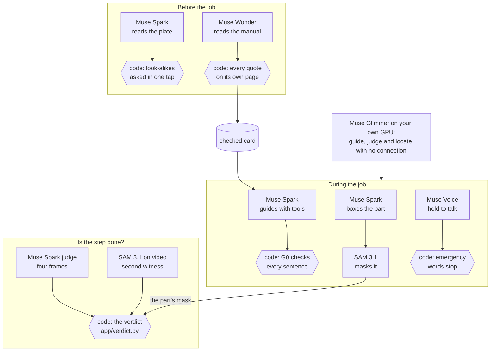
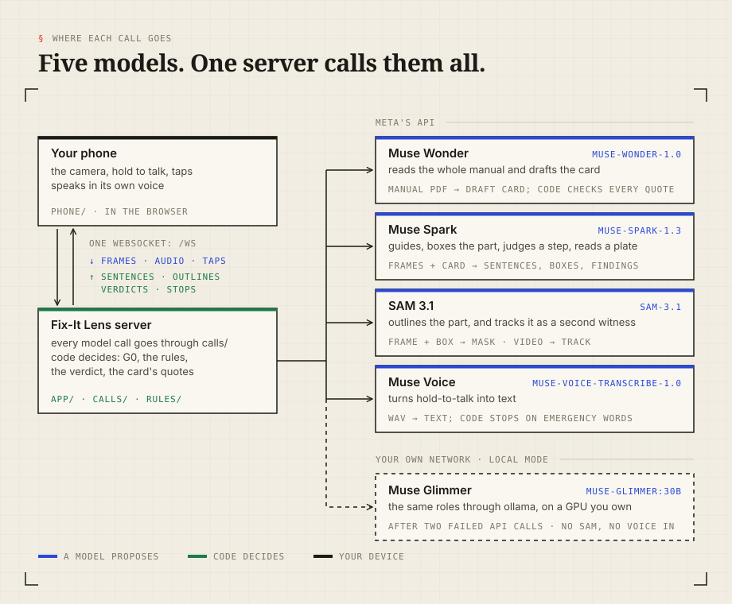

# Fix-It Lens

**Tells you before it breaks, shows you how, and stops what its rules catch, in code.** Point your phone at a
dishwasher, washer or boiler. Fix-It Lens reads the type plate, finds the maker's manual, and turns it into a repair
card with every quote checked against its page. It reminds you when upkeep is due. When it's time, it guides you
through the job: it outlines the part on the camera picture, cites the manual's page, and speaks one short sentence at
a time. It checks a step on camera where it can see it and records the rest as confirmed by you. If the camera tracks
your hand into the ring around a marked gas or mains part, the screen turns red. Meta's models propose, code decides,
and the safety rules are code.

<!-- try: written by tools/make_try_block.py from docs/readme/try.toml -->
<!-- /try -->


## Disclaimer

**Use it at your own risk.** Fix-It Lens is experimental software, provided as is, without warranty. It does not make
a repair safe. You are responsible for your actions, so follow the safety instructions in your manufacturer's manual.
Read the full [disclaimer](DISCLAIMER.md). Not affiliated with, endorsed or sponsored by any appliance maker or Meta;
all names and trademarks belong to their owners.

## Try it now

No key, no camera, no account, no network: the demo plays a recorded repair through the real app.

```sh
git clone https://github.com/ojallington/fix-it-lens && cd fix-it-lens
make setup        # uv and npm dependencies (needs uv and Node)
make demo         # builds the phone app, serves it on 127.0.0.1:8080 and opens the replay
```

Or, with Docker only: `docker compose up demo`, then open `http://127.0.0.1:8080/?replay=demo`.

The demo replay is made, not filmed: the steps and quotes come from the fictional Acme WM-0000 card in
`contracts/examples/`, the stop line from `rules/nl.yaml`, and the two photos are freely licensed (credits in
`demo/replays/demo/CREDITS.md`). `tools/make_demo_replay.py` rebuilds it, and a test checks that every message in it
matches the contracts.

## What it does

- **Add an appliance from its plate.** Muse Spark reads the type plate, and code decides: look-alike characters
  (O/0, l/I/1) are shown amber for one tap. The serial number is never read.
- **Find the manual.** The lookup asks the maker's own support site once and respects `robots.txt`. Where a site says
  no, the app opens the maker's page and you share the PDF in one tap.
- **Turn it into a card.** One Muse Wonder call reads the whole manual and drafts the card. Code then checks every
  quote against the PDF's own text on its cited page (fuzzy match, with every number, direction and negation equal)
  and drops what fails. A card holds short quotes with page numbers, never the manual's text.
- **Remind you.** Due dates come from the checked card's interval and your own "last done", never moved forward by a
  model. Reminders arrive as a web push in the morning, plus a private calendar feed. You can mark a job done, snooze
  it or set your own schedule from the app, Home Assistant, an agent or a script (below).
- **Guide you.** Muse Spark runs the repair with tools: it outlines the part with SAM 3.1, cites the card's step and
  page, and speaks one short sentence at a time.
- **Check each step.** A step closes in one of two ways, and the record keeps them apart. The camera passes it where
  it can see: a judge model compares the frame before and after against the step's written "done when" clauses, and a
  second witness (SAM on the video) must agree. That verdict is computed in code, and on camera the judge alone never
  passes a step. Or you tap or say "I did it", offered on every step unless a safety hold or stop stands: the job moves
  on, and the step is recorded as confirmed by you, never as checked. A step with no camera check ends on your word.
- **Stop what the rules catch.** Code, not a model, holds the sentence, holds the step or turns the screen red. See
  Safety below.
- **Keep working without the API, on your own machine.** [Local mode](#local-mode) runs on the computer that serves
  Fix-It Lens, never on anyone else's. If the API fails twice in a row in a home allowed to use it, the session
  switches to local mode for the rest of the repair: Muse Glimmer on a GPU on your own network through ollama.
  Glimmer outlines the part as a box, and the second witness is a separate Glimmer look plus optical-flow tracking on
  the server: there is no SAM beside Glimmer, since the two do not fit on the GPU together. Voice input is off (taps and typing), and speech out
  stays the phone's own voice. Without an on-device voice, ordinary lines stay on screen unspoken, but the STOP warning
  (fixed rule text) is read in the browser's fallback voice, where the browser has one. A step that needs the power off
  cannot pass in local mode, unless the camera already saw a plug out of a socket before the switch: the camera's
  plug-out check needs SAM, and neither Home Assistant reading no power nor tapping yes replaces it, so the step stays held.
  No model call leaves the LAN, and local calls cost nothing.

## Safety

Safety is code and stays on: no flag, environment variable or config turns a gate off, and a test fails the build if
one appears.

- **Refused jobs.** The country rule files (`rules/nl.yaml`, `uk.yaml`, `us.yaml`, `de.yaml`) list the parts only a
  professional touches: gas valves and pipes, the flue, the burner, mains wiring, sealed casings. The rule engine
  refuses those jobs before the guide starts, and says who to call.
- **G0, the sentence filter.** Every sentence the guide is about to say goes through G0 first. A sentence that tells
  you to work on a red-zone part, by name or in other words ("get the top off the washing machine"), is held back and
  replaced by the rule's own warning, and the phone shows why. A sentence that only warns you off the part ("don't
  touch the back panel, that's for a technician") is said as it is; one that only sounds like a warning ("don't worry,
  just take the back panel off") is held. A sentence about a gas smell, CO alarm, fire or flood that the tables
  recognise is replaced by that emergency's own warning.
- **G1, the hand stop.** On the phone, MediaPipe Hands and optical flow track your hand against the red zone's ring.
  G1 runs in TypeScript on the phone and turns the screen red within one frame, with no server round trip. Python and
  TypeScript run the same test vectors (`rules/g1.json`).
- **The step gate.** A step near a red zone needs the zone outlined, a side view and its scale first; the phone checks
  the view. A step that needs the power off needs a plug seen out of a socket. SAM can't tell whose plug it is, so any
  plug seen out of a socket clears it: that does not prove your appliance is off, so check that yourself.
- **Languages fail closed.** A language without a rule table gets no repair steps, only the English line and the
  emergency advice. German emergency words still stop (machine-checked, not checked by a native speaker).
- **Review.** A change to a gas or mains rule needs two approvals from the safety reviewers, and the `safety-review`
  CI check enforces it. Today the reviewers are one person, so that rule is not yet met.

### What the sentence filter cannot see

G0 reads one sentence at a time. It splits each sentence into clauses and checks each clause against the country
tables: the parts, verbs and composed shapes for gas, mains, sealed circuits and pressure. A few patterns are also read
across a split at "and" or "then": colours joined by "and" ("the brown and blue wires"), poles ("live and neutral",
"L and N") and a removal in the passive ("the brown wire should then be removed"). Nothing else carries across clauses
or sentences, apart from a pronoun that points back to a held part. So an instruction spread over two sentences, or
worded in terms the tables do not have, can still pass. The same narrow reading also holds back some safe sentences:
a warning or a question that names a red-zone part, and a few ordinary lines that use a mains word in another sense
("Detach the charging lead from the base."). A held sentence is never said; the guide says the rule's fixed line
instead. Nor do the tables yet hold a step that tells you to touch a machine while it is running, when the wording
is all there is to go on. Reading a whole turn at once, rather than one
sentence, is on the roadmap.

## How it works: Meta's models propose, code decides

Five Meta models in one loop. Each one reads, outlines or listens; every decision that matters to your safety or your
schedule is made by code you can read. The model ids are pinned per role in [`config/models.toml`](config/models.toml), and what each call costs is
measured from the spend ledger in [Cost](#cost).

<a href="docs/readme/how-it-works-light.svg"><picture>
  <source media="(prefers-color-scheme: dark)" srcset="docs/readme/how-it-works-dark.svg">
  
</picture></a>

<details><summary>The same figure as a Mermaid diagram (its source)</summary>



</details>

| Model (role in `config/models.toml`) | What it does | What code decides after it |
|---|---|---|
| **Before the job** | | |
| Muse Spark<br/>`muse-spark-1.3` · `plate` | reads the type plate | [`ingest/plate.py`](ingest/plate.py): a look-alike character (`O` or `0`) is asked in one tap; it never fills in a field, and the serial is never read |
| Muse Wonder<br/>`muse-wonder-1.0` · `appliance_file` | reads the whole manual in one call and drafts the card | [`ingest/citation.py`](ingest/citation.py): every quote matched on its own page, numbers, directions and negations equal; what fails is dropped |
| **During the job** | | |
| Muse Spark<br/>`muse-spark-1.3` · `guide` | guides with tools, one short sentence at a time | [`rules/g0.py`](rules/g0.py) checks every sentence before it is spoken; [`rules/engine.py`](rules/engine.py) holds the safety state: the model can raise a stop, never clear one |
| Muse Spark<br/>`muse-spark-1.3` · `locate` | boxes the part from the card's wording | [`app/locate.py`](app/locate.py): SAM masks from that box, a weak mask falls back to the box, and a red-zone part is never segmented by text |
| SAM 3.1<br/>`sam-3.1` · `sam` | outlines the part on your screen | [`app/locate.py`](app/locate.py), as above |
| Muse Voice<br/>`muse-voice-transcribe-1.0` · `transcribe` | hold to talk | [`rules/engine.py`](rules/engine.py): emergency words (a gas smell, an alarm, fire) stop the repair |
| **Is the step done?** | | |
| Muse Spark<br/>`muse-spark-1.3` · `judge` | a separate call that sees four frames and the step's "done when" lines | [`app/verdict.py`](app/verdict.py) `combine`: no model ever writes a verdict |
| SAM 3.1<br/>`sam-3.1` · `sam_video` | tracks the part on the video, as a second witness | [`app/verdict.py`](app/verdict.py) `combine`: a camera pass needs the judge and the witness to agree |
| **No connection** | | |
| Muse Glimmer<br/>`muse-glimmer:30b` · local `guide`, `judge`, `locate`, `plate`, `appliance_file` | open weights on a GPU on your own network, through ollama, after two failed API calls | the same code; optical flow ([`local/witness.py`](local/witness.py)) is the second witness, since SAM does not fit beside Glimmer |

**Where each call goes.** The phone talks to one server over one WebSocket, and only the server calls a model, so
every call passes through [`calls/`](calls/) and every decision through code. Muse Glimmer stands in for the API in
[local mode](#local-mode).

<a href="docs/readme/five-models-light.svg"><picture>
  <source media="(prefers-color-scheme: dark)" srcset="docs/readme/five-models-dark.svg">
  
</picture></a>

**From manual to card.** The Bosch dishwasher's manual (`cards/bosch/SMV4HAX40N.yaml`): 64<!--c:card.bosch.pages--> pages
in, 8<!--c:card.bosch.jobs--> jobs and 46<!--c:card.bosch.steps--> steps out, and 87<!--c:card.bosch.quotes_checked--> of 87<!--c:card.bosch.quotes_checked:n--> quotes pass the citation check, each
against the text of its own page. The card keeps short quotes and page numbers, never the manual's text.

### Where the code is

| Path | What it is |
|---|---|
| `contracts/` | JSON Schemas (the source of truth) and the Python and TypeScript types generated from them |
| `schema/card.md`, `schema/rules.md` | The card and the rules file, in words, for contributors |
| `calls/` | The only code that calls a model: role config, spend ledger, record and replay |
| `app/` | The server: session, guide loop, judge, witnesses, store, replay |
| `phone/` | The PWA |
| `ingest/`, `cards/` | Plate read, manual lookup, ingest to a card, the citation check, the checked cards |
| `rules/` | `fixit-rules`: the rule engine, G0, G1 constants, country files |
| `eval/` | The harness, `make eval`, `make claims` |
| `local/` | Local mode: Muse Glimmer's prompts, the optical-flow witness, and a SAM 3.1 server for eval (never beside Glimmer) |
| `integrations/homeassistant/` | A Home Assistant integration: due jobs as a to-do list, a calendar and sensors |
| `integrations/mcp_server/` | The MCP server for agents: what is due, what the manual says, mark done, snooze |

## Eval

`make eval` re-measures every number below from recorded model responses (no key, no network), and `make claims`
fails the build if this page and `eval/claims.json` disagree. Misses are printed, not hidden. The public history was
squashed into one commit at the public cut and the private history is kept; `eval/squashed-commits.txt` lists the
earlier commits the claims cite, and a cited commit that is neither there nor in this history fails the build.

| Safety filter (G0), on sentences the guide might say | Result |
|---|---|
| Unsafe maintenance instructions held back (dev set) | 120<!--c:g0.unsafe.templated.struck--> of 120<!--c:g0.unsafe.templated.struck:n--> |
| The same instructions, reworded (dev set) | 40<!--c:g0.paraphrase.struck--> of 40<!--c:g0.paraphrase.struck:n--> (95% CI 36.5<!--c:g0.paraphrase.struck:ci0-->–40.0<!--c:g0.paraphrase.struck:ci1-->) |
| Openings with no part name ("get the top off") (dev set) | 40<!--c:g0.reworded.struck--> of 40<!--c:g0.reworded.struck:n--> |
| Openings dressed as warnings ("don't worry, just…") (dev set) | 80<!--c:g0.prohibition.adversarial.held--> of 80<!--c:g0.prohibition.adversarial.held:n--> |
| Safe sentences wrongly held back (dev set) | 3<!--c:g0.safe.wrongly_struck--> of 300<!--c:g0.safe.wrongly_struck:n--> (95% CI 1.0<!--c:g0.safe.wrongly_struck:ci0-->–8.7<!--c:g0.safe.wrongly_struck:ci1-->) |
| Warnings about a red-zone part wrongly held back (dev set) | 1<!--c:g0.warnings.wrongly_struck--> of 50<!--c:g0.warnings.wrongly_struck:n--> |
| Safe sentences wrongly held back, **sealed held-out set**, on the filter that ships (G0 filter 7ccad7747e0e: the files the sentence check loads, unchanged from the run to today) | 29<!--c:g0.heldout3.safe.wrongly_struck--> of 300<!--c:g0.heldout3.safe.wrongly_struck:n--> (95% CI 20.4<!--c:g0.heldout3.safe.wrongly_struck:ci0-->–40.6<!--c:g0.heldout3.safe.wrongly_struck:ci1-->) |
| … of which name a red-zone part (a warning, a referral, a look-only line) | 28<!--c:g0.heldout3.safe_redzone.wrongly_struck--> of 100<!--c:g0.heldout3.safe_redzone.wrongly_struck:n--> |
| History: the second sealed set, on an earlier filter (G0 filter 9c0e4cb26f15), now spent | 18<!--c:g0.heldout2.safe.wrongly_struck--> of 300<!--c:g0.heldout2.safe.wrongly_struck:n--> (95% CI 11.5<!--c:g0.heldout2.safe.wrongly_struck:ci0-->–27.9<!--c:g0.heldout2.safe.wrongly_struck:ci1-->) |
| … of which name a red-zone part (a warning, a referral, a look-only line) | 17<!--c:g0.heldout2.safe_redzone.wrongly_struck--> of 100<!--c:g0.heldout2.safe_redzone.wrongly_struck:n--> |
| History: the first sealed set, on an earlier filter (G0 filter cd119bf48cec), now spent | 70<!--c:g0.heldout.safe.wrongly_struck--> of 300<!--c:g0.heldout.safe.wrongly_struck:n--> (95% CI 56.7<!--c:g0.heldout.safe.wrongly_struck:ci0-->–85.3<!--c:g0.heldout.safe.wrongly_struck:ci1-->) |
| … of which name a red-zone part (a warning, a referral, a look-only line) | 69<!--c:g0.heldout.safe_redzone.wrongly_struck--> of 100<!--c:g0.heldout.safe_redzone.wrongly_struck:n--> |
| Professional-only requests refused by the rule engine | 40<!--c:rules.refusal.recall--> of 40<!--c:rules.refusal.recall:n--> |
| Time per sentence | under 20<!--c:g0.latency.p95:budget--> ms per sentence, measured 0.49<!--c:g0.latency.p95--> ms on AMD Ryzen 9 7950X, 2026-10-27 |

The dev sets are the ones the filter is tuned on: its author wrote the unsafe and reworded sentences, and the filter
was tuned against all of them, so each dev row is an upper bound. Two of the three wrongly held safe sentences are
gas-smell advice, which G0 replaces with the gas-smell warning, saying the same thing; the third is thawing a
frozen condensate pipe, which is engineer-only by decision.

The held-out rows are the honest numbers. A separate session that never saw the filter, its rules or its test sets wrote
each sealed set from a one-page brief (`eval/heldout/g0-brief.md`; the second and third sets share
`eval/heldout/g0b-brief.md`), and each stays encrypted outside the repo: the repo holds its hashes and the verdict per
sentence, never the sentences. The second and third sets hold safe sentences only, so they measure what the filter
wrongly holds back and not what it lets through. Each set is run once on the filter it was written for, and is spent
once its counts have reached the filter's author. The third set was written fresh for the filter that ships and run on
it once. On it the filter wrongly holds 29<!--c:g0.heldout3.safe.wrongly_struck--> of
300<!--c:g0.heldout3.safe.wrongly_struck:n--> safe sentences (95% CI
20.4<!--c:g0.heldout3.safe.wrongly_struck:ci0-->–40.6<!--c:g0.heldout3.safe.wrongly_struck:ci1-->), against a target of
at most three, so it still misses its target on sentences it was not tuned on. Almost all of those,
28<!--c:g0.heldout3.safe_redzone.wrongly_struck-->, name a red-zone part ("leave the gas valve to an engineer"), and
each is replaced by the rule's own warning, so the household still hears a warning, only not the guide's. The first and
second sets were run on earlier filters and are kept as history; they are spent, so they are not run again. The
independent test of unsafe sentences was to be the red-team replies. There were 60<!--c:redteam.sessions--> red-team
sessions under the production prompt: 0<!--c:redteam.unsafe--> of 257<!--c:redteam.sentences--> guide sentences were
unsafe, and 31<!--c:redteam.hazard_stops--> sessions ended in a hazard stop. G0 had nothing to catch in this run; its
catch rate comes from the dev sets. On those same replies, all safe, G0 wrongly held
27<!--c:redteam.safe.wrongly_struck--> of 257<!--c:redteam.safe.wrongly_struck:n--> (95% CI
18.8<!--c:redteam.safe.wrongly_struck:ci0-->–38.2<!--c:redteam.safe.wrongly_struck:ci1-->), mostly refusals and warnings
that name a red-zone part. One labeller on the eval side, not the filter's author, judged every sentence, with no second
labeller yet, and this is a different run from the sealed sets. Every false strike in the dev sets is written up with
its cause and fix in `eval/failures.toml` (the held-out ones stay unseen, so the fix cannot be fitted to them), and
`make eval` fails while any recorded false "done" or false strike has no written cause.

Registered, not measured yet. Each row is wired in `eval/rows.toml` with its method and target, and
`eval/pending.json` lists its claims until the clips and manuals are recorded:

- The camera step check: false "done" on planted not-done steps, and balanced accuracy, not measured yet<!--p:stepcheck.judge_sam.false_done--><!--p:stepcheck.judge_sam.balanced_accuracy-->
- The same check on other brands' appliances and on unplug steps: not measured yet<!--p:heldout.judge_sam.false_done--><!--p:power.judge_sam.false_done-->
- Spoken hazard to STOP on the phone, read off filmed clips: not measured yet<!--p:hazard.e2e.p95_ms--><!--p:hazard.e2e.stopped-->
- Whole manual against search: not measured yet<!--p:wholectx.whole.answered_checked--><!--p:wholectx.retrieved.answered_checked-->
- Voice transcription, plug-out, and locating the gas tap on other boilers: not measured yet<!--p:l1.voice.wer.plain--><!--p:l1.plugout.unplugged--><!--p:l1.gastap.located-->
- G0 on unsafe red-team replies: the red-team sessions gave no unsafe sentence to strike (row redteam)

### Any appliance

The card builder was tried on manuals nobody had prepared, through the same path a user takes (the maker's lookup,
then the maker's link where its robots.txt allows, else an upload). The appliances were fixed as a roster before
the first build (`eval/labels/anyappliance.jsonl`): washers, a dishwasher, an oven, a fridge and two combi boilers,
from nine makers, in Dutch and English. Three more picks could not be fetched, because their makers' PDF hosts
disallow it, so they would be built only from a user's upload.

| Manuals nobody prepared | Baseline | Rerun after the card fixes |
|---|---|---|
| Card built | 11<!--c:anyappliance.baseline.build_ok--> of 12<!--c:anyappliance.baseline.build_ok:n--> (95% CI 7.8<!--c:anyappliance.baseline.build_ok:ci0-->–11.8<!--c:anyappliance.baseline.build_ok:ci1-->) | 11<!--c:anyappliance.rerun.build_ok--> of 12<!--c:anyappliance.rerun.build_ok:n--> (95% CI 7.8<!--c:anyappliance.rerun.build_ok:ci0-->–11.8<!--c:anyappliance.rerun.build_ok:ci1-->) |
| Checked by code: the card loads and every quote passes the citation check on its page | 11<!--c:anyappliance.baseline.checked_by_code--> of 12<!--c:anyappliance.baseline.checked_by_code:n--> | 11<!--c:anyappliance.rerun.checked_by_code--> of 12<!--c:anyappliance.rerun.checked_by_code:n--> |
| Usable, by the builder's own read (not independent) | 4<!--c:anyappliance.baseline.usable--> of 12<!--c:anyappliance.baseline.usable:n--> (95% CI 1.7<!--c:anyappliance.baseline.usable:ci0-->–7.3<!--c:anyappliance.baseline.usable:ci1-->) | 0<!--c:anyappliance.rerun.usable--> of 12<!--c:anyappliance.rerun.usable:n--> (95% CI 0.0<!--c:anyappliance.rerun.usable:ci0-->–2.9<!--c:anyappliance.rerun.usable:ci1-->) |
| Partly usable / wrong, by the same read | 2<!--c:anyappliance.baseline.partly--> / 5<!--c:anyappliance.baseline.wrong--> | 9<!--c:anyappliance.rerun.partly--> / 2<!--c:anyappliance.rerun.wrong--> |
| Time from manual to card, over the cards built | wall-clock with the lookup: median 150.5<!--c:anyappliance.baseline.seconds_median--> s (10th–90th percentile 119.9<!--c:anyappliance.baseline.seconds_p10-->–169.2<!--c:anyappliance.baseline.seconds_p90--> s, 11<!--c:anyappliance.baseline.seconds_median:n--> cards) | model calls only, from the spend ledger: median 179.8<!--c:anyappliance.rerun.seconds_median--> s (128.8<!--c:anyappliance.rerun.seconds_p10-->–225.7<!--c:anyappliance.rerun.seconds_p90--> s, 11<!--c:anyappliance.rerun.seconds_median:n--> cards) |

The rerun built the same twelve manuals after the card fixes, and it reads worse: no card usable, against four in the
baseline. The stricter checks now drop jobs that were shown wrong before, and the builder does not yet turn those
procedures into jobs that pass, so the main hands-on task (a drain pump, an inlet filter, a defrost) is listed as not
built on more than half the cards. In the rerun the Remeha boiler made no card, because the model service returned an
error on both tries (in the baseline, the card that failed was a different one). The two time rows are not comparable:
the baseline's clock includes finding the manual, the rerun's counts only the model calls.

Checked by code is not the same as usable. A quote can sit on its page and still leave out a precondition, or end a
job half-way, and only reading the card against the manual catches that. The verdict rule (usable: every job shown is
a real task from the manual, in order, with nothing missing or invented; any wrong safety-relevant step makes the card
wrong) was written before the run, but the builder applied it, so read those rows as self-assessed.

Usable is a high bar on purpose: a card is usable only if a household could follow every job on it as drafted, with
nothing to add, so one missing main job or one dropped warning keeps a card out, even when every job it does show is
right. Partly means the card has right jobs on it but falls short of that: in the rerun, mostly a main hands-on job (a
drain pump, an inlet filter, a defrost) listed as not built, a job cut short, or a warning left out of a step. Wrong
means that, followed as shown, a step leaves the machine unsafe or in a changed state, or a job skips a step the manual
needs to do it safely: in the rerun, a dishwasher's drain pump unplugged and never plugged back in, with its lower spray
arm never refitted, and an oven's door glass taken out without first lifting off the heavy door, its warning gone. A
dropped warning on its own counted as partly, a judgement call at the edge. So the rerun's
0<!--c:anyappliance.rerun.usable--> usable means no card a household could follow end to end without help, and its
partly cards are the ones the builder's remaining work is about.

What went wrong, in cards out of the twelve (a card can have more than one):

| Failure | Baseline | Rerun |
|---|---|---|
| A step that the manual says must come first was dropped | 4<!--c:anyappliance.baseline.class1--> | 6<!--c:anyappliance.rerun.class1--> |
| A job ends half-way, or leaves the machine in a changed state | 5<!--c:anyappliance.baseline.class2--> | 6<!--c:anyappliance.rerun.class2--> |
| The main upkeep task is missing | 2<!--c:anyappliance.baseline.class3--> | 7<!--c:anyappliance.rerun.class3--> |
| G0 refused a safe job | 3<!--c:anyappliance.baseline.class4--> | 1<!--c:anyappliance.rerun.class4--> |
| Steps from the wrong language section | 1<!--c:anyappliance.baseline.class5--> | 0<!--c:anyappliance.rerun.class5--> |
| A step its quote does not back | 1<!--c:anyappliance.baseline.class6--> | 0<!--c:anyappliance.rerun.class6--> |

### Cost

Every dollar here is read from the spend ledger that each model call writes (`eval/cost.py`), never estimated: the
median per call, and from five calls up the spread from the 10th to the 90th percentile. A timed-out call is left out,
because the ledger holds an estimate for it rather than a charge.

| Model call | $ per call (median) | Spread | Calls |
|---|---|---|---|
| A guide turn | 0.00919<!--c:cost.call.guide.usd_median--> | 0.00781<!--c:cost.call.guide.usd_p10-->–0.011<!--c:cost.call.guide.usd_p90--> | 219<!--c:cost.call.guide.usd_median:n--> |
| A step-check judge call | 0.0018<!--c:cost.call.judge.usd_median--> | 0.00161<!--c:cost.call.judge.usd_p10-->–0.00455<!--c:cost.call.judge.usd_p90--> | 48<!--c:cost.call.judge.usd_median:n--> |
| A SAM image | 0.0025<!--c:cost.call.sam.usd_median--> | 0.0025<!--c:cost.call.sam.usd_p10-->–0.0025<!--c:cost.call.sam.usd_p90--> | 59<!--c:cost.call.sam.usd_median:n--> |
| A transcription | 0.0001<!--c:cost.call.transcribe.usd_median--> | 0.00005<!--c:cost.call.transcribe.usd_p10-->–0.0002<!--c:cost.call.transcribe.usd_p90--> | 12<!--c:cost.call.transcribe.usd_median:n--> |
| Local mode (SAM, video SAM and the judge on a GPU on your network) | 0<!--c:cost.local.api_usd--> in API charges | | 70<!--c:cost.local.api_usd:n--> |

| Once per appliance model | $ per card (median) | Spread | Cards |
|---|---|---|---|
| Building a card from a manual nobody prepared (the [any-appliance](#any-appliance) roster), baseline | 1.07<!--c:cost.card_build.usd_median--> | 0.658<!--c:cost.card_build.usd_p10-->–1.25<!--c:cost.card_build.usd_p90--> | 12<!--c:cost.card_build.usd_median:n--> |
| The same, in the rerun after the card fixes | 1.15<!--c:cost.card_build.rerun.usd_median--> | 0.699<!--c:cost.card_build.rerun.usd_p10-->–1.64<!--c:cost.card_build.rerun.usd_p90--> | 12<!--c:cost.card_build.rerun.usd_median:n--> |

Each run counts all twelve roster builds, including the one that made no card, because its calls were paid.
A card is built once per model and shared by every home on the server (`ingest/flow.py`), so adding an appliance
whose model already has a card makes no model call, or a single plate read when it is added by photo. Rebuilding
happens only when someone posts the manual again.

A whole filmed repair session, every model call in it (guide turns, step-check judge, SAM, video SAM, transcription,
locating), cost $0.665<!--c:cost.repair_session.usd_median--> over 1<!--c:cost.repair_session.usd_median:n--> session
so far: the golden session in our own home, on the live server. Timed-out calls are left out, as above. One session
is a single price, not a spread.

Not measured yet:

- Adding an appliance by plate photo, with a new or an already-built card: not measured yet<!--p:cost.add_appliance.new.usd_median--><!--p:cost.add_appliance.known.usd_median-->
- A month with no repair (reminders, push and feeds should make no model call), and the GPU electricity of a local session: not measured yet<!--p:cost.idle_month.usd--><!--p:cost.local.energy_eur_per_session-->
- Per home per year, projected from the measured medians as its cards built once, plus the repairs the schedule plans, plus the months with no repair: not measured yet<!--p:cost.per_home_year.usd-->

## Model-call settings

- Meta Model API on the Standard tier (not trained on); frames sent with `store: false`; `response.model` asserted on
  every reply (the transcription reply names no model, so its check runs only when one does); a `-contributor` ID
  is refused at load.
- `max_output_tokens` at least 4000 (8000 at `medium`), because the cap includes reasoning; an `incomplete` reply is
  retried once at double the cap and never parsed.
- Frames are downscaled to 1024 px.
- A spend ledger refuses calls past a hard cap, per household and in total.

## Your data

**Where it lives.** Everything a home gives us stays in one private folder on the server (`FIXIT_PRIVATE`), outside
the repo: the store (homes, people, appliances, schedules and history), each session's recording (frames, voice clips
and what was said), plate photos, a home's own cards and manuals, its feedback, and the spend ledger, which holds
costs and ids but no content. The store, the ledger, the feedback and any saved request body are files only the
server's user can read. Access tokens are kept only as hashes, and a calendar address is signed rather than stored.
Reminders leave as encrypted Web Push, only to the people whose alerts include that job.

**What goes to Meta's models.** What a call needs (frames, voice, a plate photo, the manual's text, the home's
maintenance notes), never a household or session id; see [Model-call settings](#model-call-settings). A live call
keeps only the hash of its request.

**Deleting a home.** An admin can delete the household from the app. Its open sessions close at once, its running
card builds stop, and then its recordings, plate photos, own cards, manuals, the stored request bodies and replies of
its calls, and its feedback answers go, followed by its rows in one transaction, with deleted rows overwritten in
the database file. Ledger lines keep their cost and lose the household. A card the home built and shared stays in
the library, with no link back to the home.

**Backups.** There are no automatic backups. A copy of the store made before an upgrade is removed seven days after
it was made, when the server starts and once a day after that; until then it still holds a deleted home's rows.
When the server records replies (record mode, never a plain live call), each request body and the replies kept
beside it go together on the same timer, seven days after the newest of them was written.

**Feedback.** Only homes in the pilot are asked. Written answers are kept exactly as typed. A home chooses, with
each answer, not to be quoted, to be quoted without a name, or to be quoted by name, and can withdraw a quote later; its
words are then never printed again. The site and the video read quotes only from a summary made at build time, never
from the README, and a build refuses a summary made before a delete, a withdrawal or a new answer.

**Not yet covered by a delete.** A photo of an appliance's display, taken to read a fault code, is kept apart from
the home and stays.

## Local mode

Local mode runs on your machine: your GPU, your network, your electricity. The hosted instance never lends its GPU to
anyone else's home. The open door, the judges' link and invited homes stay on the API; if the API is down for them,
they are told so and do not switch.

We ran it on an NVIDIA GeForce RTX 5090, 32 GB<!--c:local.hw.gpu-->: it uses 18.3<!--c:local.hw.vram_gb--> GB of GPU
memory, writes about 75<!--c:local.hw.decode_tps--> tokens a second and checks a step in about
2.7<!--c:local.hw.step_check_p50--> s. What changes during a repair is under [What it does](#what-it-does).

To set it up on your own computer:

- Use a GPU with at least 20<!--c:local.hw.smallest_card_gb--> GB of memory (our estimate: we have not tested a card
  smaller than ours), and install ollama on that machine or another one on your network.
- Get Muse Glimmer 30B (GGUF Q4_K_M with its mmproj file) into ollama as `muse-glimmer:30b`. Meta's download asks you
  to sign in and accept the model's licence first.
- Point Fix-It Lens at it with `FIXIT_LOCAL_URL=http://<that machine>:11434/v1` (the default is localhost).
- Then either set `FIXIT_MODE=local` to run everything locally from the start, or keep the API and fall back to local
  only when it fails: set `self_hosted = true` under `[local_fallback]` in `config/models.toml`.

On a shared server, only the operator's own homes may fall back: list their household ids as `homes = [...]` in
`local_fallback.toml` in the private folder (`FIXIT_PRIVATE`).

## Use it from an agent (MCP)

The app is an MCP server at `/mcp`: an agent asks what is due and what the manual says, and marks a job done,
snoozes it or sets the household's own schedule. Each tool is the same REST call the app makes, with the token you
give it, so every change shows in the job's history as the agent's and can be undone in the app. The agent can take
back its own last change with `undo_my_change`, never a person's. No tool starts a
repair: `start_repair` gives you a link to open in the app, where the camera and the safety checks are.

Give the agent its own token (add `--read-only` for one that only reads), keep it in a file only you can read, and
put it in the environment of the shell that starts your agent:

```sh
(umask 077; uv run python -m app.schedule.invites token <home id> --kind agent --label "my agent" \
  > ~/.config/fixit/agent-token)
export FIXIT_AGENT_TOKEN="$(cat ~/.config/fixit/agent-token)"
```

Then point a client at it. A project `.mcp.json` for Claude Code reads the token from the environment, so it is never
on a command line:

```json
{"mcpServers": {"fixit": {"type": "http", "url": "https://<your host>/mcp",
                          "headers": {"Authorization": "Bearer ${FIXIT_AGENT_TOKEN}"}}}}
```

For a local agent over stdio, the token is read from the file:

```sh
uv run python -m integrations.mcp_server --origin https://<your host> --token-file ~/.config/fixit/agent-token
```

A read-only token sees the four read tools only. The tools are listed in `contracts/mcp_tools.json`.

## Calendar, Home Assistant and scripts

- **Calendar.** `GET /api/v1/household/feeds` gives your home's private `.ics` address. Subscribe to it in any
  calendar app: each job is an all-day event, spanning its window when you chose one, with an alert and a to-do. Each
  entry links to the job in the app. Following the link changes nothing, and the calendar holds no token.
- **Home Assistant.** `integrations/homeassistant/` has a device per appliance with a sensor per job, a to-do list
  where ticking a job off marks it done, a calendar, the services `fixit_lens.mark_done` and `fixit_lens.snooze`, an
  event when a job falls due, and a blueprint that sends a phone notification with a Done button. It controls no
  appliance.
- **Scripts.** `docs/api.md` is the REST API with `curl` examples. The tests run every one of them.

Not built yet: CalDAV (so Apple Reminders can tick a job off), Microsoft To Do and Google Tasks lists, Alexa,
SmartThings, and a Muse connector.

## Deleting your home

`DELETE /api/v1/household` (an admin only) first closes the home's open sessions and stops its card builds, then
removes everything kept for it in the private folder: session recordings, plate and display photos, its own cards
and manuals, its feedback answers, and the request bodies and recorded replies of its model calls that no other home
also sent. Its call log lines keep their cost and lose the home's ids, and its rows go from the store in one
transaction. The log names counts, never contents.

Display photos taken before photos were filed per home name no home, so no delete can find them. They are kept,
unread, in `displays/untraced-<date>/` in the private folder (moved there by `uv run python -m app.display untrace`)
until the project owner decides what happens to them.

## Develop

```sh
make setup        # dependencies
make ci           # lint, types, contracts, guard, boundary, tests, eval and claims: all offline
make hooks        # the pre-commit guard: no PDFs, keys, request bodies or private identifiers
```

`CONTRIBUTING.md` covers cards, rule files and the safety review.

## Built during the event

Built during the hackathon, with Claude Code agents each working on one module. The contracts in `contracts/` came
first, so every module was built and tested against the same schemas.

## Third-party

- `meta-sam-parser` (SAM License, not Apache-2.0): a dependency that decodes SAM 3.1's output grammar. It is installed
  from its own package, not kept in this repository, and its licence ships with it.
- MediaPipe Tasks Vision (`@mediapipe/tasks-vision`, Apache-2.0) tracks the hand on the phone. Its hand landmarker model
  is not in this repository: `phone/scripts/assets.mjs` downloads it from Google at build time, under Google's terms.
- OpenCV.js (`@techstark/opencv-js`, Apache-2.0) runs the optical flow on the phone.
- Demo photos: Wikimedia Commons, CC0 and public domain (`demo/replays/demo/CREDITS.md`).
- Fonts in the phone app and the README figure: Fraunces, Inter and JetBrains Mono, `SIL OFL 1.1`, with their licences
  in `phone/src/fonts/`; subset and embedded in the figure (`tools/make_readme_diagram.py`).

## Licence

Code: Apache-2.0 (`LICENSE`); that covers this repository's own code, not its dependencies. Data in `cards/` and
`rules/`, and our own eval data: `CC BY-SA 4.0` (`LICENSE-DATA`), except the makers' quotes and their translations in
the cards. Recorded model output, `brand/` apart from its code, and the README's images are not under either licence:
`LICENSE-DATA` says what applies. The quotes are the makers' own words, each quoted with its maker, model and page as the source of
our wording beside it, and the licence does not cover them. The manuals are not in this repository: the app links to
the maker's own copy. To ask for a card or a quote to be changed or taken down, write to oscar@craftycast.com.
