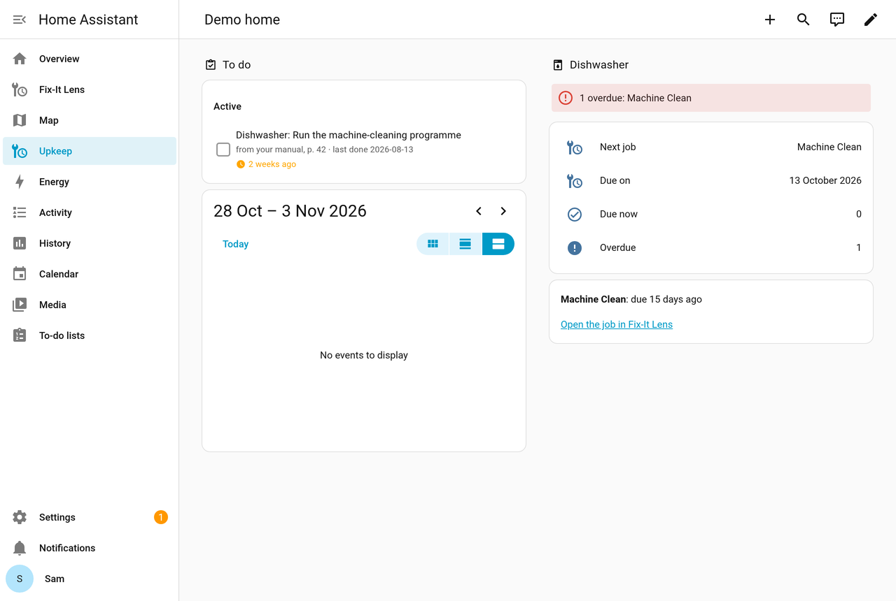

# Fix-It Lens for Home Assistant

Your home's upkeep schedule in Home Assistant, from your Fix-It Lens. The home is a service device holding the to-do
list and the calendar; under it each appliance is a device ("Dishwasher"), with the maker and model from its card and a
link to the app, holding that appliance's sensors:

- `sensor.<appliance>_<job>_next_due`: a date sensor per upkeep job, named in a few words as the reminder names it
  ("Dishwasher Filters due"). Its attributes hold the card's full `title`, hold the status (`upcoming`, `due`,
  `overdue`, or `none` until you say when it was last done), the manual's interval and page, your own schedule if you
  set one, a window's last day, a snooze, the `job` to pass to the services, and a `link` to the job in the app;
- `sensor.<appliance>_next_job`: the appliance's soonest dated job by name, with its `due_on` and `status`;
- `sensor.<appliance>_overdue_jobs`: how many of the appliance's jobs are overdue, and which;
- `sensor.<appliance>_due_jobs`: how many are due now (on or past their date, or inside your window) and not yet
  overdue, and which;
- `todo.fix_it_lens_upkeep`: the jobs that are due; ticking one off marks it done today;
- `calendar.fix_it_lens_upkeep`: one all-day event per job from its due date (a window spans its whole range),
  named short ("Dishwasher: Machine clean") with the full instruction in its description;
- the `fixit_lens_job_due` event, once when a job becomes due and once when it becomes overdue, with the job, its
  appliance, the manual's line and the link;
- two services: `fixit_lens.mark_done` (`job`, optional `date`) and `fixit_lens.snooze` (`job`, and `until` or
  `days`). A snooze only moves a date later.

It reads the due jobs every minute, so a job marked done or snoozed in the app changes here within a minute. The
home's and appliances' names, makers and models are read every half hour, and at once when a job of an appliance not
seen yet comes in; an appliance removed in the app loses its device at that half-hourly read.

**Download diagnostics** (the integration's menu) gives what the last read held: the home, its appliances and their
jobs, with the token and the Fix-It Lens address (also in each job's link) redacted, and a ready dashboard for those
appliances (below).

Every change shows in the job's history in Fix-It Lens as Home Assistant's, and can be undone there. Due dates come
from the manual and your own schedule, worked out by Fix-It Lens. The integration controls no device and calls no
Home Assistant service: its devices are only Home Assistant's way of grouping the entities. Names come in English
and Dutch.

## The appliances Home Assistant already knows

At the end of setup, and later under the integration's **Configure**, it lists the appliances Home Assistant's device
registry knows that your Fix-It Lens home does not have yet: Home Connect's dishwasher, a Miele washer, a boiler
named as one. Nothing is ticked at first, and nothing leaves Home Assistant until you submit; then only each ticked
one's maker, model, kind and name are sent, through Fix-It Lens's usual add. A model the card library has links its
card at once; any other gets its manual's pages, and its card is made on request: an add from Home Assistant never
builds a card or spends from the home's budget. Lights, speakers and anything with no maker, model or kind are not
listed; the kind comes from the device's name or model (English, Dutch, German, French) or, for Bosch, Siemens, Neff
and Gaggenau, from the model code. Adding needs a token that can write.

The same mapping fits any source that names a maker and a model: SmartThings and Miele devices come through the
registry already (their integrations are on the list of appliance sources), and a Matter appliance carries its kind
as a device type (0x0075 dishwasher, 0x0073 washer, 0x007C dryer, 0x0070 fridge, 0x007B oven), which would replace
the name guess with the device's own word once Home Assistant exposes it on the device. A source outside Home
Assistant (SmartThings' own API, say) would need only to produce the same four fields for a ticked device.

## A ready dashboard



`dashboards/fixit_lens.yaml` is a dashboard from Home Assistant's own cards only (no custom card, no JavaScript): the
to-do list and the calendar, then a section per appliance with a red line when a job is overdue (amber when one is
due now and none overdue), its next job, the date and how many are due and overdue, "due in 3 days" in words, and
**Open the job in Fix-It Lens** (the job's `link`: the app's address and the job, no token). The file is written by
`dashboards/make.py` for the demo home's appliances (dishwasher, washer, boiler, fridge, oven).

For your own home, take it from **Download diagnostics**: its `dashboard` is the same dashboard for your appliances
by their names. Paste this into a new dashboard (Settings, Dashboards, Add dashboard, "New dashboard from scratch",
then the menu, Edit dashboard, the menu, Raw configuration editor): the `dashboard` value, as it is (JSON is YAML).
Or use the file as a YAML-mode dashboard:

```yaml
lovelace:
  dashboards:
    fixit-lens:
      mode: yaml
      filename: fixit_lens.yaml
      title: Fix-It Lens
      icon: mdi:wrench-clock
      show_in_sidebar: true
```

A single appliance's section, to paste as a card group into a dashboard you already have, is one entry of its
`sections`. An appliance renamed in the app gets new entity ids; download the diagnostics again.

## A notification with a Done button

`blueprints/automation/fixit_lens/job_due_notify.yaml` sends a notification to a phone with the Home Assistant app
when a job falls due, naming the job and its appliance, with three buttons: **Done**, **In 7 days** (you choose the
days) and **Open** (the job in Fix-It Lens). In your quiet hours (22:00 to 08:00 unless you change them; the same time
twice means none) it holds the notification and sends it when they end. A restart of Home Assistant while one is held
drops it; the job stays on the to-do list. Import it with the button in the published repository's README, or
Settings → Automations → Blueprints → Import with its address, or copy it to `config/blueprints/automation/`, then
create an automation from it and pick the phone.

## Install

Copy `custom_components/fixit_lens` into your Home Assistant `config/custom_components/`, restart, then Settings →
Devices & services → Add integration → Fix-It Lens. (HACS needs the integration at a repository's root, so it cannot
install it from this folder; `addon/stage.py --repo` writes a repository it can.) It asks for the Fix-It Lens address
and a token your home made for Home Assistant (`INSTALL.md`). With the add-on (`addon/`), "Connect to Home Assistant"
in its sidebar panel does this step for you. A read-only token works
for the sensors, the list and the calendar; ticking off, the services and the Done button need one that can write.

## Tests

`./test.sh` runs the integration and the blueprint in Home Assistant's own test harness (it makes a Python 3.13 env
on first run). The core (`core.py`, no Home Assistant import) is also tested against the real API in
`tests/l5/test_ha_integration.py`.
